<div dir="rtl" align="right">

<p align="center">
  
</p>

<p align="center">
  <a href="../../releases/latest"></a>
  <a href="../../actions/workflows/build-windows.yml"></a>
  
  <a href="LICENSE"></a>
</p>

# مستر میل

**مستر میل** سه ابزار جدا را در یک اپلیکیشن دسکتاپ حرفه‌ای جمع کرده است:

| ابزار قبلی | کاری که می‌کرد | حالا در مستر میل |
| --- | --- | --- |
| [MailCrawlerDK](https://github.com/mmhdih/MailCrawlerDK) | گرفتن ایمیل و نام تجاری فروشنده از پنل ادمین | مرحله «گیرندگان» کمپین + ابزار «کراولر ایمیل» |
| [ExelSeprator](https://github.com/mmhdih/ExelSeprator) | جداسازی اکسل بر اساس یک ستون | مرحله «پیوست» کمپین + ابزار «جداساز اکسل» |
| [MassMailSender](https://github.com/mmhdih/MassMailSender) | ارسال ایمیل انبوه شخصی‌سازی‌شده | مراحل «متن ایمیل» و «ارسال» کمپین |

دیگر لازم نیست خروجی یک برنامه را دستی به برنامه بعدی بدهید. **فقط شناسه فروشنده‌ها یا فایل گزارش را بدهید**؛ مستر میل ایمیل‌ها را از پنل می‌گیرد، سهم هر فروشنده را از فایل جدا می‌کند، متن ایمیل را با شما آماده می‌کند و برای همه می‌فرستد.

رابط کاربری از نو و به سبک اپل (macOS) طراحی شده است: کاملاً راست‌چین، فونت وزیرمتن، پوسته روشن و تیره، و طراحی‌ای که هر مرحله را قدم‌به‌قدم جلو می‌برد.

<p align="center">
  
</p>

## فهرست

- [مسیر جدید کار](#مسیر-جدید-کار)
- [امکانات](#امکانات)
- [دانلود و اجرا](#دانلود-و-اجرا)
- [راهنمای قدم‌به‌قدم کمپین](#راهنمای-قدمبهقدم-کمپین)
- [ابزارهای مستقل](#ابزارهای-مستقل)
- [تنظیمات](#تنظیمات)
- [امنیت و حریم خصوصی](#امنیت-و-حریم-خصوصی)
- [اجرا و ساخت از سورس](#اجرا-و-ساخت-از-سورس)
- [ساختار پروژه](#ساختار-پروژه)
- [عیب‌یابی](#عیبیابی)
- [مجوز](#مجوز)

## مسیر جدید کار

مسیرهای قبلی بازبینی و ساده شده‌اند. هر کاری که قبلاً چند برنامه و چند فایل واسط لازم داشت، حالا یک مسیر است:

```
شناسه‌ها یا فایل اکسل ─► دریافت ایمیل از پنل ─► نوشتن متن ─► جداسازی و پیوست ─► ارسال و گزارش
```

| قبلاً | حالا |
| --- | --- |
| اول در کراولر یک فایل اکسل با ستون `seller id` می‌ساختید، خروجی می‌گرفتید، ستون‌ها را برای ارسال‌کننده تغییر نام می‌دادید | شناسه‌ها را **بچسبانید** (با هر جداکننده، حتی اعداد فارسی) یا هر فایلی را بدهید؛ ستون‌ها خودکار تشخیص داده می‌شوند |
| ایمیل همه فروشنده‌ها در هر اجرا دوباره کراول می‌شد | **دفترچه فروشندگان** ایمیل‌های پیدا‌شده را نگه می‌دارد؛ فقط موارد جدید کراول می‌شوند |
| فایل گزارش را جدا در اسپلیتر تقسیم می‌کردید و پوشه را به ارسال‌کننده می‌دادید | گزینه «فایل اختصاصی هر فروشنده» همان فایل را خودکار جدا و به ایمیل همان فروشنده پیوست می‌کند |
| متن ایمیل باید در یک فایل Word آماده می‌شد | ویرایشگر داخلی با **قالب‌های آماده**، **نوشتن با هوش مصنوعی**، درج جای‌نگهدار و پیش‌نمایش زنده؛ وارد کردن از Word هم هست |
| ستون‌های فایل گیرندگان باید دقیقاً `seller id` و `seller name` و `email` می‌بودند | هر ستونی از فایل منبع به‌صورت جای‌نگهدار (مثل `{کالا}`) در متن قابل استفاده است |
| خطای یک گیرنده = گم شدن در لاگ | گزارش اکسل هر ارسال، وضعیت هر گیرنده، و دکمه **ارسال دوباره ناموفق‌ها** |
| برای هر ایمیل یک اتصال جدید به سرور | یک اتصال برای کل ارسال، با اتصال مجدد خودکار و استراحت دوره‌ای برای جلوگیری از محدودیت سرور |

## امکانات

**کمپین یکپارچه**
- پنج مرحله با نوار پیشرفت به سبک اپل: منبع، گیرندگان، متن ایمیل، پیوست، بازبینی و ارسال
- ذخیره خودکار همه چیز؛ هر کمپین را هر وقت بخواهید ادامه می‌دهید
- ویرایش ایمیل و نام هر گیرنده در جدول، یا حذف او از ارسال
- ایمیل آزمایشی برای خودتان، حالت شبیه‌سازی (Dry Run)، توقف موقت و ادامه، پایان در هر لحظه
- گزارش اکسل راست‌چین از وضعیت تک‌تک گیرندگان

**کراول از پنل**
- باز کردن کروم و انتظار برای ورود شما، با تشخیص خودکار ورود
- ذخیره نشست کروم؛ دفعات بعد بدون ورود دوباره
- تلاش مجدد، راه‌اندازی دوباره مرورگر و تشخیص انقضای نشست
- آدرس صفحه و سلکتورها از تنظیمات قابل تغییرند

**متن ایمیل**
- شش قالب آماده (گزارش ماهانه، اطلاعیه، درخواست مدارک، تسویه، دعوت به کمپین، یادآوری)
- نوشتن یا بهبود متن با Claude؛ بدون کلید API هم نویسنده آفلاین یک پیش‌نویس منظم می‌سازد
- جای‌نگهدارها: `{seller_name}`، `{seller_id}`، `{email}`، `{date}` (تاریخ شمسی)، `{month}`، `{row_count}`، `{file_name}` و همه ستون‌های فایل منبع
- ایمیل HTML زیبا و راست‌چین همراه نسخه متنی ساده، امضای ثابت، Reply-To و BCC به خودتان

**پیوست‌ها**
- فایل اختصاصی هر فروشنده از فایل منبع (اکسل یا CSV)
- پوشه فایل‌های آماده (فایلی که نامش با شناسه فروشنده شروع می‌شود)
- یک یا چند فایل مشترک برای همه
- انتخاب اینکه اگر فایل یک نفر پیدا نشد ایمیل او ارسال شود یا نه

## دانلود و اجرا

۱. از بخش [Releases](../../releases/latest) فایل `MasterMail-vX.Y.Z-portable-x64.exe` را دانلود کنید.
۲. روی آن دوبار کلیک کنید. نصب لازم نیست.

پیش‌نیازها روی ویندوز ۱۰ و ۱۱:
- **Google Chrome** برای کراول پنل (درایور کروم خودکار دریافت می‌شود)
- **Microsoft Edge WebView2** که روی ویندوز ۱۰ و ۱۱ از قبل نصب است. اگر نبود، برنامه در یک پنجره Edge یا Chrome باز می‌شود.

تنظیمات و دفترچه فروشندگان در پوشه `MasterMail-data` کنار فایل exe ذخیره می‌شوند (اگر آن پوشه قابل نوشتن نباشد، در `%LOCALAPPDATA%\MasterMail`). فایل‌های خروجی در `Documents\MasterMail` ساخته می‌شوند.

## راهنمای قدم‌به‌قدم کمپین

### ۱. منبع

شناسه‌ها را بچسبانید یا فایل اکسل را رها کنید. برنامه ستون شناسه، ایمیل و نام را تشخیص می‌دهد، تعداد فروشنده‌های یکتا را نشان می‌دهد و اگر هر فروشنده چند ردیف داشته باشد، پیشنهاد می‌کند فایل هر فروشنده جدا و برایش پیوست شود.

<p align="center">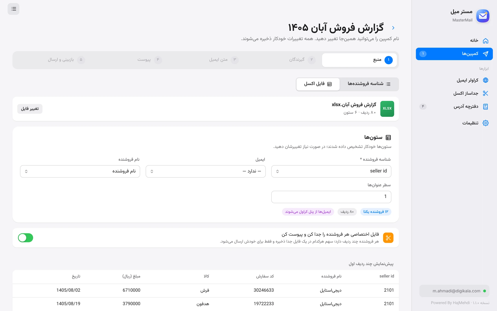</p>

### ۲. گیرندگان و دریافت ایمیل از پنل

ایمیل‌هایی که در فایل یا دفترچه هستند فوراً پر می‌شوند. برای بقیه «دریافت خودکار از پنل» را بزنید. بار اول کروم باز می‌شود و برنامه منتظر می‌ماند تا وارد پنل شوید:

<p align="center">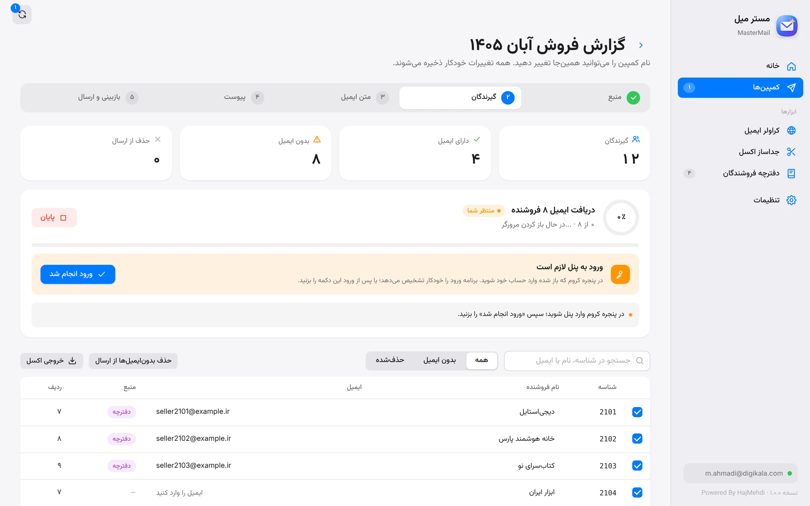</p>

پس از ورود، کراول انجام می‌شود و جدول زنده پر می‌شود. اگر ایمیل کسی در پنل هم نبود، آن را دستی وارد کنید یا او را از ارسال حذف کنید:

<p align="center">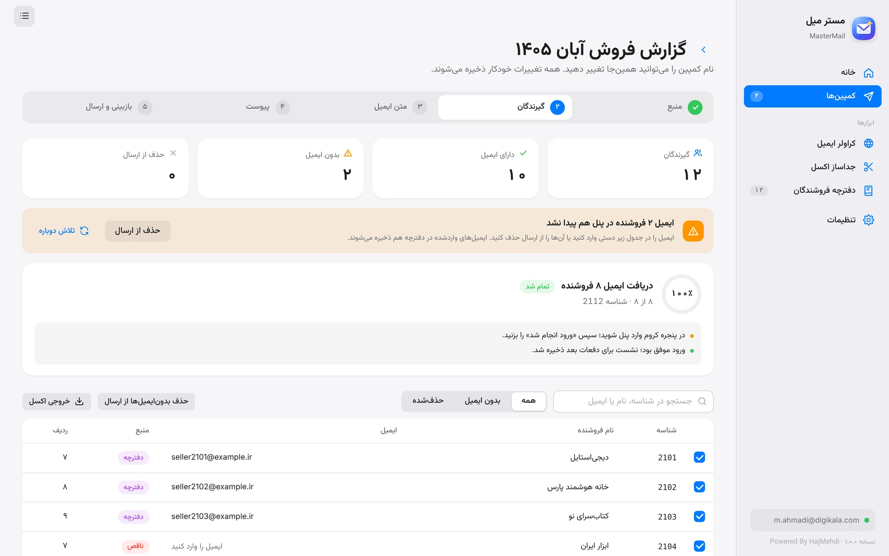</p>

### ۳. متن ایمیل

از یک قالب شروع کنید، از هوش مصنوعی بخواهید بنویسد یا متن Word را وارد کنید. پیش‌نمایش سمت چپ متن واقعی هر گیرنده را با فایل پیوستش نشان می‌دهد.

<p align="center">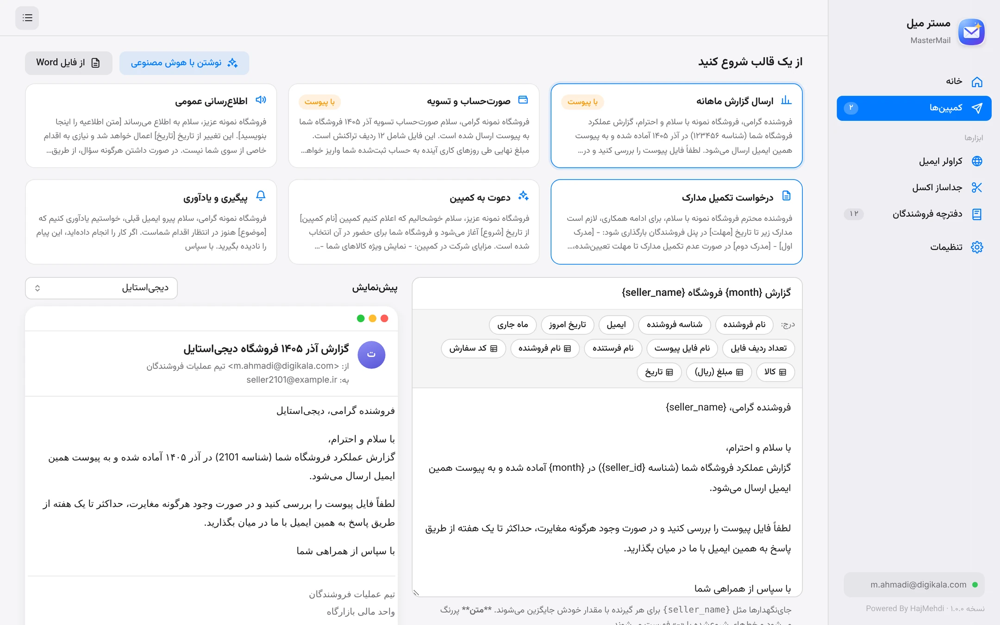</p>

<p align="center">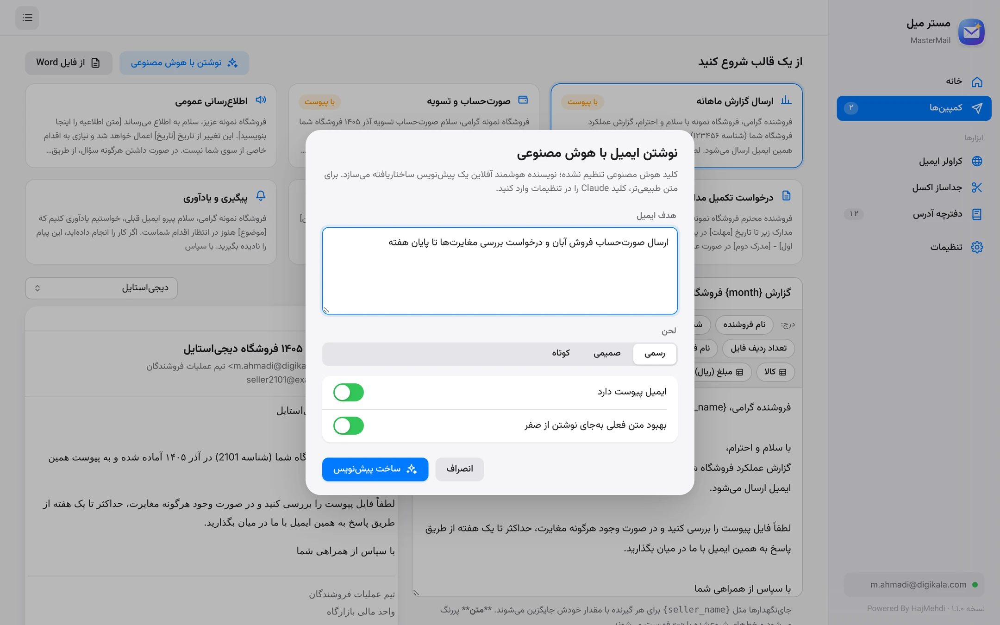</p>

### ۴. پیوست

نوع پیوست را انتخاب کنید. در حالت «فایل اختصاصی هر فروشنده»، با «ساخت فایل‌ها» فایل منبع برای همه گیرندگان جدا می‌شود و وضعیت تطابق را می‌بینید.

<p align="center">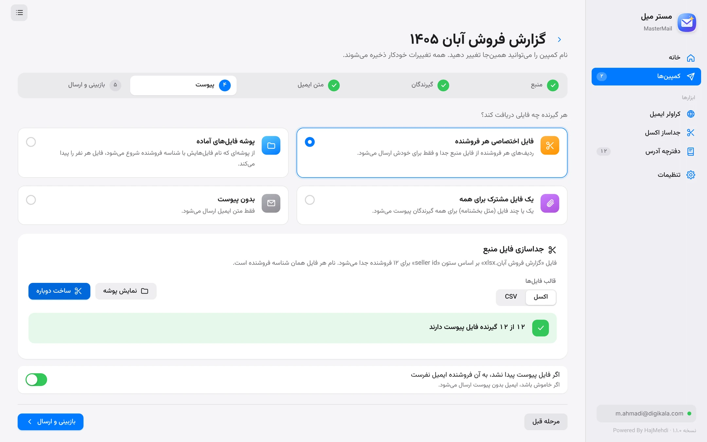</p>

### ۵. بازبینی و ارسال

چک‌لیست نشان می‌دهد چه چیزی آماده است. یک ایمیل آزمایشی برای خودتان بفرستید، سرعت را انتخاب کنید و ارسال را شروع کنید.

<p align="center">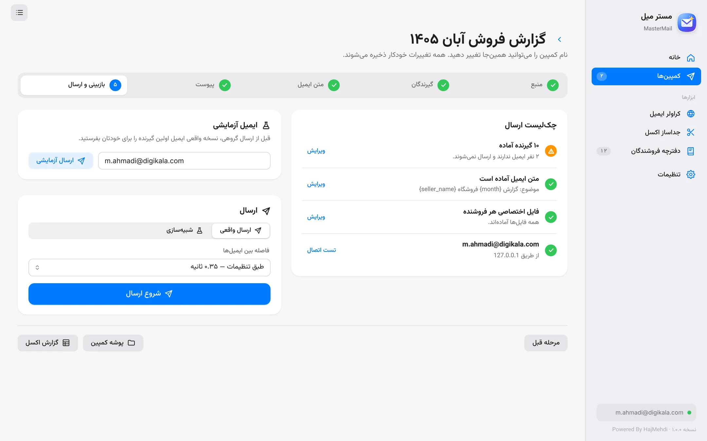</p>

پیشرفت زنده، وضعیت هر گیرنده و در پایان گزارش اکسل:

<p align="center">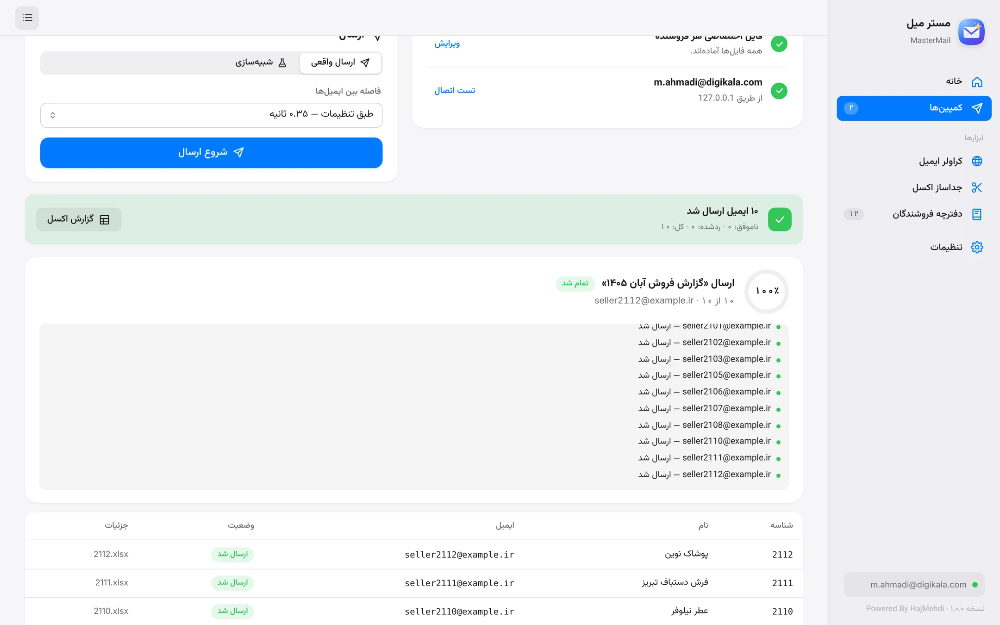</p>

## ابزارهای مستقل

ابزارهای قبلی جداگانه هم در دسترس‌اند.

**کراولر ایمیل:** شناسه‌ها یا فایل را بدهید و خروجی اکسل ایمیل و نام تجاری بگیرید. نتایج در دفترچه هم ذخیره می‌شوند.

<p align="center">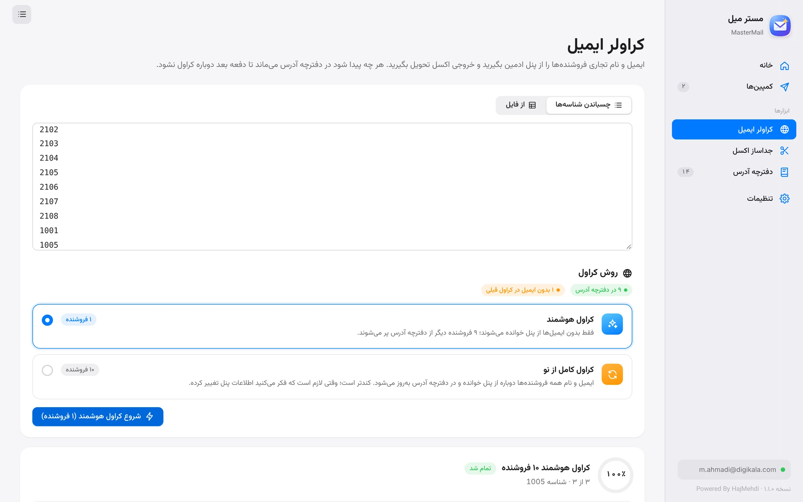</p>

**جداساز اکسل:** هر فایلی را بر اساس هر ستونی به فایل‌های جدا (اکسل یا CSV) یا یک فایل چندشیتی تبدیل کنید. نام فایل‌ها برای ویندوز امن می‌شوند و عنوان ستون‌ها حفظ می‌شود.

<p align="center">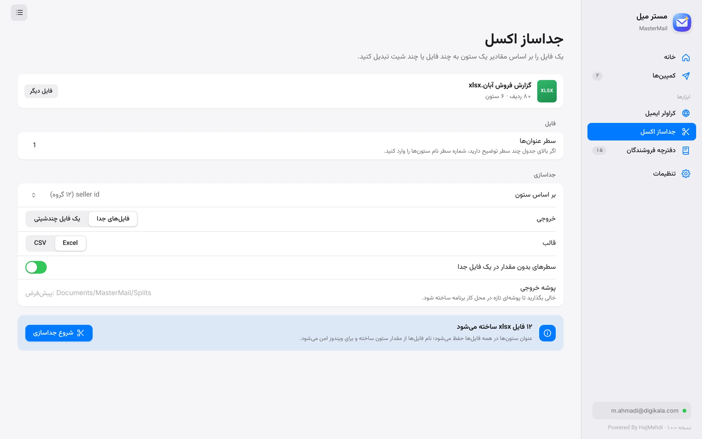</p>

**دفترچه فروشندگان:** همه ایمیل‌هایی که تا حالا پیدا شده، با امکان جستجو، ویرایش، وارد کردن از اکسل و خروجی گرفتن.

<p align="center">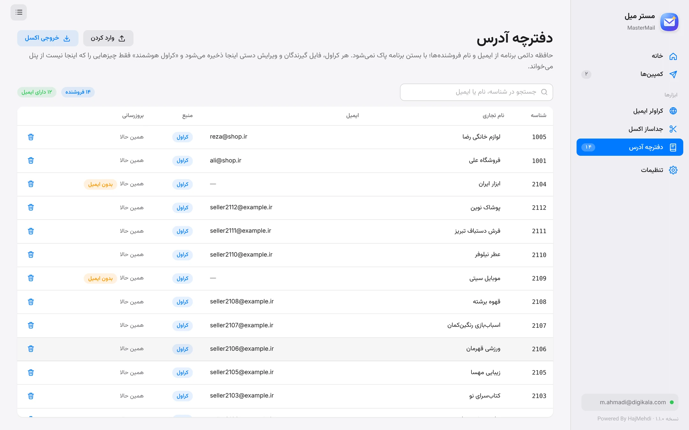</p>

## تنظیمات

<p align="center">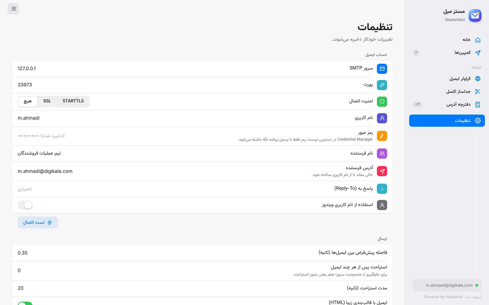</p>

| بخش | توضیح |
| --- | --- |
| حساب ایمیل | سرور (پیش‌فرض `mail.digikala.com:587`)، نوع امنیت (STARTTLS، SSL یا هیچ)، نام کاربری، رمز، نام و آدرس فرستنده، Reply-To. اگر نام کاربری خالی بماند، نام کاربری ویندوز استفاده می‌شود. |
| ارسال | فاصله بین ایمیل‌ها، استراحت پس از هر چند ایمیل، HTML، BCC به خودتان، امضا |
| کراولر پنل | آدرس صفحه فروشنده با `{id}`، سلکتور ایمیل و نام، اعتبار دفترچه (روز)، تلاش مجدد، ذخیره نشست، حالت مخفی، مسیر Chrome و chromedriver |
| هوش مصنوعی | کلید API Claude و انتخاب مدل (پیش‌فرض Claude Opus 5.5). اختیاری است. |
| ظاهر و فایل‌ها | پوسته خودکار، روشن یا تیره، و محل ذخیره خروجی‌ها |

<p align="center">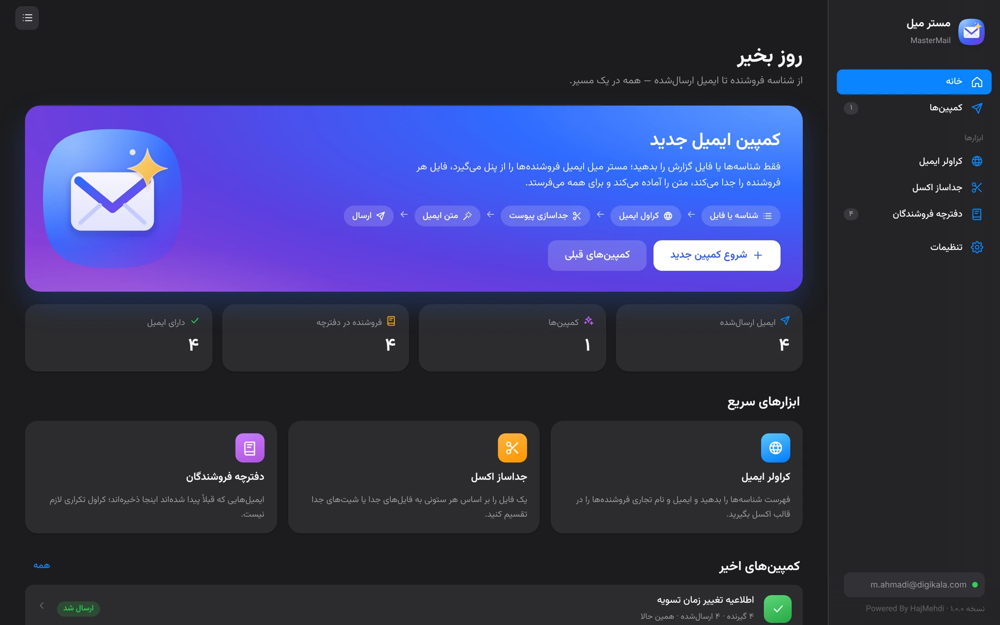</p>

## امنیت و حریم خصوصی

- رمز ایمیل و کلید API در **Windows Credential Manager** ذخیره می‌شوند و هرگز در فایل تنظیمات نوشته نمی‌شوند.
- رابط کاربری از یک سرور محلی روی `127.0.0.1` بارگذاری می‌شود که فقط با یک توکن تصادفی همان اجرا پاسخ می‌دهد. هیچ پورتی روی شبکه باز نمی‌شود.
- داده فروشنده‌ها فقط روی همین کامپیوتر می‌ماند. تنها وقتی «نوشتن با هوش مصنوعی» را بزنید، هدف ایمیلی که نوشته‌اید (و متن فعلی، اگر بهبود متن را انتخاب کنید) به سرویس Claude فرستاده می‌شود. اطلاعات گیرندگان ارسال نمی‌شود.
- پیش از هر ارسال گروهی، ایمیل آزمایشی و حالت شبیه‌سازی را امتحان کنید.

## اجرا و ساخت از سورس

نیازمند پایتون ۳٫۱۱ یا بالاتر:

```bash
git clone https://github.com/mmhdih/MasterMailApp.git
cd MasterMailApp
pip install -r requirements.txt
python main.py
```

گزینه‌های اجرا:

```bash
python main.py --browser   # باز کردن در مرورگر پیش‌فرض
python main.py --serve     # فقط سرور محلی و چاپ آدرس آن
python main.py --version
```

اجرای تست‌ها (بدون نیاز به کروم یا سرور ایمیل واقعی؛ یک پنل و یک سرور SMTP آزمایشی محلی ساخته می‌شود):

```bash
pip install -r requirements-dev.txt
python -m pytest tests -q
```

اجرای رابط کاربری با داده نمونه (پنل و سرور ایمیل آزمایشی):

```bash
python scripts/demo_server.py --login
```

ساخت فایل exe روی ویندوز:

```bash
pip install -r requirements-dev.txt
python packaging/make_version_info.py
pyinstaller --noconfirm --clean MasterMail.spec
```

خروجی در `dist\MasterMail.exe` ساخته می‌شود. GitHub Actions با هر push تست‌ها را اجرا و exe را می‌سازد و با هر تگ `v*` یک Release منتشر می‌کند.

## ساختار پروژه

```
main.py                      نقطه شروع: سرور محلی + پنجره دسکتاپ
mastermail/
  service.py                 همه منطق اپ (کمپین، کراول، جداسازی، ارسال، دفترچه)
  server.py                  API محلی، رویدادهای زنده (SSE) و فایل‌های رابط کاربری
  crawler.py                 موتور کراول Selenium (از MailCrawlerDK)
  splitter.py, naming.py     جداسازی اکسل و نام‌گذاری امن (از ExelSeprator)
  mailer.py                  شخصی‌سازی، HTML، اتصال SMTP (از MassMailSender)
  tabular.py                 خواندن و نوشتن xlsx، xls و csv و تشخیص ستون‌ها
  templates.py, ai.py        قالب‌های ایمیل و نویسنده هوش مصنوعی
  db.py                      SQLite: دفترچه فروشندگان، کمپین‌ها، گزارش ارسال
  jobs.py                    کارهای پس‌زمینه با پیشرفت، توقف موقت و توقف
  settings.py, paths.py      تنظیمات، رمزها در keyring، مسیرها
web/                         رابط کاربری (HTML، CSS و JavaScript بدون نیاز به build)
tests/                       تست‌ها و پنل و سرور SMTP آزمایشی
scripts/demo_server.py       اجرای رابط با داده نمونه
MasterMail.spec              پیکربندی PyInstaller
.github/workflows/           تست، ساخت exe و انتشار
```

## عیب‌یابی

<details>
<summary><b>کراول شروع نمی‌شود یا خطای chromedriver می‌دهد</b></summary>

مطمئن شوید Google Chrome نصب است. مسیر chromedriver را در تنظیمات خالی بگذارید تا خودکار هماهنگ با نسخه کروم دریافت شود (اینترنت لازم است). اگر شبکه دانلود را مسدود می‌کند، chromedriver هم‌نسخه کروم را دستی دانلود و مسیرش را وارد کنید.
</details>

<details>
<summary><b>«پروفایل کروم در پنجره دیگری باز است»</b></summary>

پنجره کرومی که برنامه قبلاً باز کرده هنوز باز است. آن را ببندید و دوباره تلاش کنید.
</details>

<details>
<summary><b>همه فیلدها «پیدا نشد» برمی‌گردند</b></summary>

ساختار صفحه پنل تغییر کرده است. در تنظیمات کراولر، سلکتور ایمیل و نام تجاری را با سلکتور CSS جدید عوض کنید.
</details>

<details>
<summary><b>خطای ورود به سرور ایمیل</b></summary>

با «تست اتصال» در تنظیمات بررسی کنید. برای Exchange سازمانی معمولاً پورت ۵۸۷ با STARTTLS و نام کاربری به شکل `user` یا `DOMAIN\user` درست است. اگر آدرس فرستنده با نام کاربری فرق دارد، آن را در «آدرس فرستنده» وارد کنید.
</details>

<details>
<summary><b>ویندوز می‌گوید «Windows protected your PC»</b></summary>

فایل exe امضای دیجیتال ندارد. روی **More info** و سپس **Run anyway** بزنید. برای اطمینان از سالم بودن فایل، SHA256 آن را با فایل `.sha256` در Release مقایسه کنید.
</details>

## مجوز

کد این پروژه تحت مجوز [MIT](LICENSE) منتشر شده است.

قلم [وزیرمتن](https://github.com/rastikerdar/vazirmatn) ساخته صابر راستی‌کردار تحت مجوز [SIL Open Font License 1.1](web/fonts/OFL.txt) همراه برنامه است.

<p align="center">
  <br>
  <b>Powered By HajMehdi</b>
</p>

</div>
